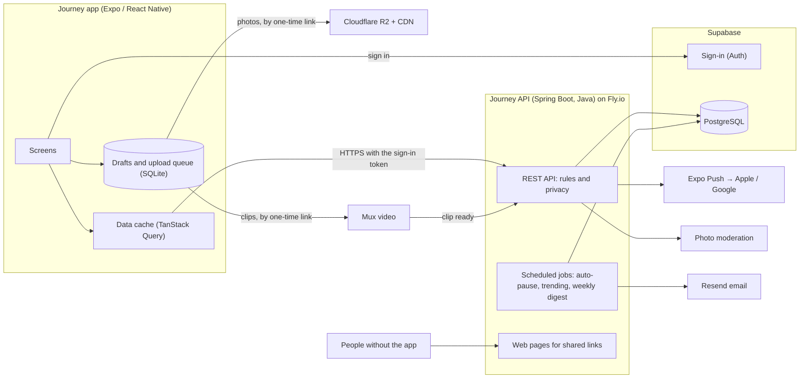

# Journey — Tech Stack and Architecture

> **Status:** final, decided on 9 Nov 2026. Versions, limits and prices were checked that day; prices can change, so look at the live page before paying for anything.
>
> **In one line:** an **Expo (React Native)** app for iOS and Android, a **Java (Spring Boot)** backend that you can read and debug, and managed services for everything that isn't worth building ourselves.

## The stack at a glance

| Layer | Choice | Why |
|---|---|---|
| Mobile app | **Expo SDK 58** (React Native 0.88, TypeScript) | One codebase for iOS and Android, built in the cloud with no Mac |
| Backend | **Journey API: Spring Boot 4 on Java** | You know Java, so you can debug and extend it. All the rules live in one place, with tests. |
| Database | **PostgreSQL**, hosted by Supabase | A relational database fits people, journeys, follows and feeds. Managed, with backups. |
| Sign-in | **Supabase Auth** | Apple, Google and email codes without building sign-in ourselves. Free up to 50,000 monthly users. |
| Photos | **Cloudflare R2** with its CDN | No charge for downloads, which is the big cost of a photo app |
| Video clips | **Mux** | Converts and streams clips. The first 100,000 minutes watched each month are free. |
| Push notifications | **Expo Push Service** | Free; one service reaches both Apple and Google |
| Email | **Resend** | Sign-in codes and the weekly digest. 3,000 emails a month free. |
| Hosting the API | **Fly.io** | About US$7 a month for an always-on server, next to the database |
| App builds and updates | **Expo Build, Submit and Update** (formerly EAS) | Store builds in the cloud, and fixes sent straight to phones |
| Web pages for shared links | Served by the Journey API, behind Cloudflare | No second codebase and no extra host |
| Analytics and crashes | **PostHog** and **Sentry** | Free tiers cover an MVP |
| Photo moderation | **AWS Rekognition** (confirmed at the safety milestone) | About US$1 per 1,000 photos |
| Automation | **GitHub Actions** | Tests on every pull request, and deploys |

## The backend decision: Java

You asked whether the backend can be Java. It can, and for this project it is the better choice. Three options were compared:

| Option | Speed to build | Who can debug it | Running it |
|---|---|---|---|
| **A. Supabase only.** The app talks to the database directly; rules are written as database policies and small TypeScript functions. | Fastest | Someone fluent in SQL policies and TypeScript | Nothing to host |
| **B. Java API on managed services (chosen).** A Spring Boot API holds all the rules. Supabase supplies the database and sign-in; other services supply storage, video and email. | 2 to 3 weeks slower than A | You, in Java, with a normal debugger and tests | One small server |
| **C. Everything in Java.** Our own sign-in, file handling and servers. | Slowest | You | The most to run and secure |

**Why B:**

1. **You can read, debug and change your own backend.** With the AI doing most of the building, the owner understanding the code is worth more than a few weeks.
2. **One place for the rules.** Who may see a private journey, what a co-author may change, what a blocked person can't do: plain Java with tests, instead of rules spread over database policies, triggers and functions.
3. **The app never talks to the database.** Old versions of the app stay on phones for months. With an API in between, the database can change without breaking them, requests can be rate-limited, and a mistake in the app can't expose the database.
4. **Nothing proprietary in the logic.** PostgreSQL, sign-in tokens and file storage are all standard, so any piece can be swapped later.

**What it costs:** about 2 to 3 more weeks for the first version (17 to 20 weeks in all) and a small server at about US$7 a month.

**What we still don't build:** sign-in, storage, video processing, email delivery and push delivery stay with managed services. Building those is where option C loses months.

## The stack, layer by layer

### Mobile app

| Concern | Choice | Why, and what else was considered |
|---|---|---|
| Framework | **Expo SDK 58**: React Native 0.88, React 19, TypeScript (strict), New Architecture | The current stable release. Flutter was the main alternative; it would add a second language (Dart) next to TypeScript. |
| Navigation and deep links | **Expo Router** | File-based routes; links to a journey open the right screen |
| Talking to the API | A typed client **generated from the API's own description** (OpenAPI, with Orval) | The app and the API can't drift apart: a changed endpoint fails the build instead of failing on a phone |
| Server data | **TanStack Query** | Caching, instant likes, retry and offline reads |
| Local state | **Zustand** | Small and simple |
| Offline drafts and upload queue | **expo-sqlite** | A real database on the phone; works in Expo Go. MMKV and op-sqlite need a custom build. |
| Uploads | **expo-file-system** upload tasks | Uploads continue when the app goes to the background on iOS |
| UI | Our own small component kit, styled with plain **StyleSheet** and a typed theme generated from `design/tokens.json` | No styling library to depend on. NativeWind 5 is still a release candidate, and Unistyles needs a custom build. |
| Glass and blur | **expo-glass-effect** on iOS 26 and later, **expo-blur** elsewhere | Real system glass where the phone supports it |
| Animation and gestures | **Reanimated 4**, **Gesture Handler** | The standard pair, included with Expo |
| Long lists | **FlashList 2** | Smooth feeds and timelines |
| Images | **expo-image** | Caching and blurred placeholders |
| Photos | **expo-image-picker**, **expo-image-manipulator** | Resize to about 2048 px on the phone before upload. The API makes the smaller versions for lists when the upload finishes (see below). |
| Video | **expo-video** to play; **react-native-compressor** to shrink clips before upload | Mux has an official guide for expo-video. The compressor needs a development build (see [testing](#testing-without-the-store-accounts)). |
| Maps | **react-native-maps** | Supports our custom "Day 14" pins and works in Expo Go. Expo's own maps library needs iOS 17 or later. |
| Sign-in | **Supabase Auth** client with **expo-apple-authentication**, native Google sign-in, and email codes | Apple and email codes work in Expo Go. Google sign-in needs a development build. |
| Push | **expo-notifications** | Works with the Expo Push Service; needs a development build |
| Forms | **React Hook Form** with **Zod** | Validation with clear messages |
| Analytics and crashes | **PostHog**, **Sentry** | |
| Tests | **Jest** with React Native Testing Library; **Maestro** for end-to-end flows later | |

### Backend: the Journey API

| Concern | Choice | Why |
|---|---|---|
| Framework | **Spring Boot 4.1** (4.2 arrives on 19 Nov 2026), Spring MVC | The mainstream Java framework, and the one most Java developers know. Quarkus and Micronaut start faster, which doesn't matter for one always-on server. |
| Java version | **Java 25** (the current long-term version) in production. The code stays compatible with Java 21, which this cloud environment has. | Spring recommends 25; virtual threads work best from Java 24 on |
| Build | **Maven** | Familiar and predictable |
| Who is calling | **Spring Security** as a resource server: it checks the sign-in token from Supabase Auth against Supabase's public keys | Standard; no passwords or sessions in our code |
| Reading and writing data | Plain SQL with Spring's `JdbcClient`, in one `Store` class per feature | One way to reach the database. JPA was used for a single table at first; two ways of doing the same thing cost more than they gave, so it was removed (November 2026). The SQL you debug is the SQL that runs. |
| Database changes | **Flyway** migrations in the repo | Every change is versioned and repeatable |
| API description | **springdoc-openapi** | Produces the OpenAPI document that the app's client is generated from |
| Rate limits | **Bucket4j**. Changes and sign-in attempts are counted in PostgreSQL, so every copy of the API shares the ceiling; reads are counted in memory | Stops abuse without adding another server such as Redis, and without a database write for every read |
| Scheduled jobs | Spring's scheduler | Auto-pause after 30 days, trending scores, reminders, the weekly digest |
| Web pages for shared links | **Thymeleaf** templates served by the API | Read-only journey and entry pages, link previews, the files that make links open the app, terms and privacy pages |
| Outside services | Official Java SDKs for Mux, Resend and S3-compatible storage; plain HTTPS for Expo Push | |
| Tests | **JUnit** with Spring's test tools, against a real PostgreSQL | Proven in this cloud environment: a test app built and passed against PostgreSQL in about 20 seconds |
| Packaging | A Docker image (`apps/api/Dockerfile`, built in CI on every push), deployed by GitHub Actions | The same image runs anywhere |
| Code style | **Spotless** with palantir-java-format; compiler warnings are errors | `./mvnw spotless:apply` formats; `./mvnw verify` (CI) fails on unformatted code or a warning |

### How the API is put together

These hold for every feature. New code follows them, and `RulesTest` and `ShapeTest` keep them true. Three more tests cover routes and queries added later: `ApiDescriptionTest` (rules read from `openapi.json` for every route: who may see what, cursors, `clientId`), `PagingTest` (every scrolled list read while it changes) and `QueryCostTest` (the main screens send the same number of statements for one journey as for twenty, and none of them reads a whole table).

| Rule | What it means |
|---|---|
| Controller, service, store | A controller turns a request into a call. A service holds the rules. A `Store` holds the SQL. No SQL anywhere else. |
| The signed-in person | Controllers take `@Me UUID me` (or `@Me CurrentUser`). Nothing reads the token by hand. |
| Who may see what | Written once, in `common/Rules.java`: which journeys a person may see, and what blocking hides (people, entries, comments, and the photos, authors and totals that stand for a shared journey). Every query uses it. A journey's owner still sees what someone who blocked them wrote in it, and an entry's author the comments under it, so that it can be removed. |
| Held for review | Every photo is checked when its upload completes (`MediaScreening`: a local stand-in, or AWS Rekognition with `JOURNEY_MODERATION_MODE=rekognition`). A flagged photo is held: its owner sees it marked, nobody else sees it, and it can't be a cover or a profile picture. Comments go through a small word filter (`WordFilter`) the same way. A journey with an open report is left out of Discover, search and suggestions, and still opens by link. A photo that is held after it became a cover or a profile picture stops being shown there the same moment. All of this is in `Rules` too (`shownMedia`, `publicMedia`, `chosenPhoto`, `shownComment`, `notUnderReview`). If the photo check can't be reached, the photo is shown and a nightly job checks it later. |
| A person decides | Nothing is removed automatically. The reviewer's pages at `/admin` list open reports, held photos and comments, and requests to delete an account made on the web. They ask for a name and the reviewers' password (`JOURNEY_ADMIN_PASSWORD`; the pages don't exist while it is unset), and an address that gets it wrong ten times waits ten minutes. Every decision is written to `review_log` with the name and the time. |
| Counts | Followers, entries, likes and comments, and the followers and following on a profile, are kept by database triggers. Java never writes them. |
| Fixed sets of words | Visibility, status, label style, media kind and the like are Java enums, lower case on the wire. The app's generated client gets exact types, and an unknown word gets its own answer. |
| Lists | A list that can grow without end is a page: `{ items, nextCursor }`, with `cursor` and `limit` (100 at most). The cursor is opaque to the app. For the lists people scroll (journeys, followers and following, comments, a story, Home) it means "after this row" (`common/Keyset.java`): it names the last row of the page before, so a row that appears or disappears between two pages neither repeats an item nor skips one, and the database goes straight to the place through an index. `PagingTest` reads every one of them while the list changes. A few short lists (blocked people, invitations, people to invite) still hold a position (`PageRequest`). "Top of" answers (Discover, search, Activity, the digest) are capped and say so. |
| A story | `GET /v1/journeys/{id}/entries` is read in pages from the start, or around any entry (`around`), with a way back (`prevCursor`). A cursor names a place in the story and a direction, so a page costs the same however far into the story it is. An entry's place in the story (`position`) comes from one numbering pass over the story's index, not from a count per entry, and `total` is the count the database keeps. A journey's page uses `GET /v1/journeys/{id}/summary` and never loads the whole story. |
| Sending twice | Creating a journey, an entry or a comment takes a `clientId` the app makes up. The same `clientId` again gives back the first one. |
| Photos | The phone asks for an upload target, sends the file there, then says it is done (`POST /v1/media/uploads/{id}/complete`). The API checks what arrived, makes two smaller versions (320 and 800 pixels) and stores them next to the original; only then can the photo be used. Every photo has a full address and a smaller one (`thumbUrl`, `coverThumbUrl`; profile pictures are always small). The same code runs with local files and with R2. |
| Failures | Always a `code` and a sentence a person can read, also for the ones nobody planned for. The app shows the sentence as it is. |
| Stand-ins | Local sign-in, local files and sample data work only with the `local` (or `test`) profile. The API refuses to start if one of them is switched on without it. |
| Scheduled jobs | A job writes a row to `job_runs` first; with several copies of the API running, only the copy that gets the row does the work. |
| Limits on the database | Every connection is opened with limits (`application.properties`, `JOURNEY_DB_OPTIONS`): a statement is stopped after 5 seconds, a wait for a lock after 3, a transaction left open and idle after 30, and a request waits 3 seconds for a free connection. One slow question then fails by itself instead of holding everything behind it. Work that is allowed to take longer says so for itself with `set local statement_timeout` in its own transaction: the trending job's weekly read and the nightly auto-pause (`UpkeepStore`), the weekly digest's "who has news" (`DigestStore.due`), and every migration that builds an index or rewrites a table (first line of the file). A new job or a new bulk delete that can run long does the same. The database's just-in-time compiler is off (`jit=off`): it only pays for long reports. |
| Indexes | An index is there for a question the code asks; `docs` and the migration say which. Every column that points at another table has one (`DatabaseShapeTest`). No index names a column that changes with every entry, like, follow or visit (a journey's counts and "last entry", an entry's counts, a follow's "last read"): such an index would be rewritten on each of those, and with it the row could no longer be changed in place (`DatabaseShapeTest` checks this too). Until now every index was made the plain way inside a migration, which is fine while the tables are empty. **Once a table holds real data, build an index with `create index concurrently`, in a migration of its own that Flyway runs outside a transaction** (a plain `create index` blocks every write to the table until it is done). |
| Links that leave the app | Built from `JOURNEY_PUBLIC_URL` when it is set, otherwise from the request. Behind a proxy, set `JOURNEY_FORWARD_HEADERS=framework`. |
| Web pages | A journey (`/j/{id}`), an entry (`/e/{id}`), a person's public journeys (`/u/{username}`) and a one-time invitation (`/i/{token}`) each have a page anyone can open; they follow the same visibility rules as the app. The legal pages (`/terms`, `/privacy`, `/guidelines`, `/contact`) and the request to delete an account (`/delete-account`) are plain pages too. The app asks the API for the link to share (`/v1/entries/{id}/share-link`, `/v1/me/share-link`); it never builds a web address itself. The two files that let a link open the app are served from `/.well-known/` once the app's ids are set (see `apps/mobile/README.md`). |
| Invite links | A one-time link for a friend who isn't on Journey yet. The token is random and only its hash is stored; it works once, for one person, for 7 days, and making a new one stops the one before. Joining by link counts against the three friends like any other invitation. |
| The API's description | `/v3/api-docs` and the try-it-out page are on in local mode and off everywhere else. |
| Places | An entry can have a point on the map (`lat`, `lng`) and a `locationPrecision`: `city` (the default) or `exact`. The exact point is stored. Other people are sent the middle of a square about 10 km wide unless the author chose `exact`; the author always gets their own point back (`entry/Place.java`). Search also finds a journey by the places of its entries. |
| The map | `GET /v1/journeys/{id}/map` gives the entries that have a point, in the order of the story (300 at most), and how many there are in all. A pin is read with only what it shows (`EntryStore.pins`), not as a whole entry. |
| Discover | Each list ("Trending now", "New journeys", "Completed") is read from the top of its own index and stops after a dozen journeys. With interests, the top inside the person's categories and the top outside them are read separately, and the leaning (below) is applied to those two dozen rows in `JourneyService.discover`. |
| Search | Each way a journey can match is asked on its own, so each uses its own index: the title, the description, the creator's name, a tag, and the places of its entries. Each gives its most followed matches, and the answers are merged and ranked by followers (`JourneyStore.search`). A tag is matched whole, the way it was saved ("#Road Trip" finds `roadtrip`). Words of fewer than three letters can't use an index: they are matched in titles, names and tags only, and give the first matches found. At most 3,000 entries are looked at for their place. |
| One person's part of a story | `GET /v1/journeys/{id}/entries?author=<username>` pages through what one author wrote. Positions and totals count within that part. |
| Clips | The same three steps as photos, but the file goes to the video service (`media/VideoService.java`): Mux, or a local stand-in that keeps the file as it is. A clip is `processing` until the service says it is ready (`POST /webhooks/mux`, signed and checked), and until then only its author sees it. On a clip, `url` and `thumbUrl` are its still frame and `playbackUrl` plays it. Three clips an entry, 60 seconds each. |

### Notifications, reminders and what is trending

**How a push is sent.** Nothing is sent while a person waits for an answer. When something happens that someone should hear about (an entry, a like, a comment, a follow, an invitation), the service says so with an event, and `notify/Outbox` writes a row to the `notifications` table in the same transaction as the change. If the change is undone, so is the row.

- **Batching:** a row has a time before which it is not sent. New entries wait 10 minutes and likes an hour; until then more of the same join the same row, so three entries become one push ("Maya added 3 entries: …"). Comments, followers and invitations go out at once.
- **Sending:** every 30 seconds `PushDelivery` takes the rows that are due (`for update skip locked`, so two copies of the API never take the same one), checks them against the person's switches, blocks and what they may still see, words them (`PushWording`) and hands them to the push service. A row is sent once; a failure is tried again up to five times.
- **Where it opens:** every push carries a path in the app (`/journey/<id>/timeline`, `/entry/<id>?comments=1`, …). The app opens only the screens it knows (`features/notifications/target.ts`); anything else opens Activity.
- **Activity** stays worked out from what happened, as before. The `notifications` table is only the list of pushes to send, and is emptied of old rows every night. Each kind of line starts from the person's own rows (the journeys they follow, the entries they wrote) and looks up what happened to each through an index (`ActivityStore`). The dot on the tab bar has its own small question, `GET /v1/activity/unseen`: one statement that asks each kind "is there anything since they last looked?" and stops at the first yes, without building the list.

**The jobs.** Each claims its row in `job_runs` first, so with several copies of the API only one does the work.

| Job | When | What it does |
|---|---|---|
| Push delivery | every 30 seconds | Sends the pushes that are due |
| Reminders | every hour | For people who have reminders on and whose own clock shows their chosen hour (7 pm unless they change it; the time zone comes from their phone): one push at most per day. A challenge gets "Day 12 of 30 is waiting" on a day without a check-in. Any other journey gets a nudge after 3, 7 and 14 quiet days and then none; quiet days are counted from when the person last posted, not from the day an entry is dated. Paused and completed journeys never get one. The people who are due are chosen by the database in one statement (`ReminderStore.due`), so the hour costs the same for ten people or ten thousand. |
| Auto-pause | daily, 04:15 UTC | An active journey with no entry for 30 days becomes paused and is marked as paused by itself, so its page can say "Paused after 30 quiet days". The owner hears once. A new entry wakes it. |
| Trending | every hour (a start of the API counts as that hour's run) | Works out the score (below) of the public journeys where something happened in the last 8 days, and stores the ones that changed, a thousand at a time |
| Weekly digest | Sundays, 18:00 UTC | One push, plus an email for people who asked for it, built from the same week as the digest page. Nothing in a week with nothing new. |

**What "Trending now" means.** A journey's score is worked out from four things anyone can check on its page:

| What | Points |
|---|---|
| Entries added in the last 7 days | 3 each, 7 entries at most (posting a lot in one day doesn't win) |
| New followers in the last 7 days | 2 each |
| People who liked or commented in the last 7 days | 1 for each person who liked something in it, 2 for each person who commented. People are counted, not likes or comments, and never the journey's own authors or a comment held for review. Likes and comments add 30 points each at most. |
| Completed in the last 14 days | 10 |
| People who follow it already | a little: the logarithm, so 1,000 followers count for about 7 points |
| Paused | the total is halved |

Discover's "Trending now" lists public journeys with at least 3 entries by this score; journeys completed more than 14 days ago leave it. **Interests lean it, they don't decide it:** in "Trending now" a journey in a category the person picked at sign-up counts for half as much again, and among new journeys it is treated as a week newer than it is. A journey nothing has happened to keeps the score it had. The code is `UpkeepStore.trendingScores` and `JourneyService.discover`.

**Outside services** each have a port (an interface), a stand-in and the real thing, chosen by a setting:

| Port | Setting | Stand-in (`local`) | The real thing | Needs |
|---|---|---|---|---|
| `PushSender` | `journey.push.mode` (`JOURNEY_PUSH_MODE`) | Writes each push to the log | `expo`: the Expo Push Service over HTTPS, 100 at a time; a phone Expo reports as gone is forgotten | Nothing to send. `EXPO_ACCESS_TOKEN` only if "enhanced security" is switched on in the Expo account. |
| `EmailSender` | `journey.email.mode` (`JOURNEY_EMAIL_MODE`) | Writes each email to the log | `resend`: Resend's Java library, with a key that makes sending twice harmless | `RESEND_API_KEY`, and `JOURNEY_EMAIL_FROM` with an address on a domain verified at Resend. Without the key the API doesn't start; `JOURNEY_EMAIL_MODE=off` runs it without email until there is one. |
| `EmailAddresses` | follows `journey.auth.mode` | The local sign-in table | Supabase's `auth.users` | The API keeps no email addresses of its own |

The stand-ins are the default with the `local` profile and refused without it, like the other stand-ins. In the app, PostHog and Sentry are switched on by `EXPO_PUBLIC_POSTHOG_KEY` (and `EXPO_PUBLIC_POSTHOG_HOST` for the EU) and `EXPO_PUBLIC_SENTRY_DSN`. Without a key nothing is loaded. What is counted is listed in `features/analytics/events.ts`: kinds and counts, never a name, an email address or anything a person wrote.

### Managed services

| Service | Choice | Why, and what else was considered | Price |
|---|---|---|---|
| Database | **PostgreSQL on Supabase** | Comes with sign-in in one account. Supabase's automatic database API is switched off: only the Journey API connects. Neon and AWS were the alternatives. | Free while building (500 MB; pauses after a week unused). Pro US$25 a month at launch. |
| Sign-in | **Supabase Auth** | Apple, Google and email codes. Clerk costs about six times more per user at scale; Firebase has no email code. | Free to 50,000 monthly users; 100,000 on Pro |
| Photos | **Cloudflare R2**, served through Cloudflare's CDN | Downloads are free. Supabase Storage and AWS S3 charge about US$0.09 per GB downloaded. | 10 GB free, then US$0.015 per GB a month |
| Video | **Mux** | Direct uploads from the phone, streaming that adapts to the connection, still frames. At our scale it is cheaper than Cloudflare Stream and api.video. | Encoding free; about US$0.0024 per stored minute a month; first 100,000 watched minutes a month free |
| Push | **Expo Push Service** | One call reaches Apple and Google | Free |
| Email | **Resend** | Simple, with an official Java SDK. AWS SES is cheaper at volume and harder to set up. | 3,000 a month free; US$20 for 50,000 |
| API hosting | **Fly.io** | The cheapest always-on option, with regions next to the database. Railway, Render and Google Cloud Run were compared; Heroku is no longer developed. | About US$7 a month for 1 GB |
| App builds and updates | **Expo services** | Builds iOS in the cloud | Free: 15 iOS and 15 Android builds a month, updates for 1,000 users. Then US$19 a month. |
| Domain, DNS, CDN | **Cloudflare** | Also in front of the share pages | Free plan |
| Analytics | **PostHog** | | 1 million events a month free |
| Crash reports | **Sentry** | | 5,000 errors a month free |
| Photo moderation | **AWS Rekognition**, to confirm at the safety milestone | Its labels tell explicit content apart from swimwear, which matters for travel photos. OpenAI's moderation service is free, but its terms for this use weren't confirmed. Clips are checked by their still frames. | About US$1 per 1,000 photos |

**Region:** the database and the API sit in the same region so they answer quickly. The default is US East (Virginia); it can be chosen when the accounts are created.

### Delivery

GitHub Actions run the app's checks (lint, types, tests) and the API's tests (against PostgreSQL) on every pull request. Merging deploys the API to Fly.io. The app goes through Expo Build (store builds), Expo Submit (upload to App Store Connect and the Play Console) and Expo Update (fixes over the air).

## Architecture



## Data model (MVP)

| Table | Key columns |
|---|---|
| `profiles` | id (= the signed-in user), username (unique), display_name, avatar, bio, link, interests[] |
| `journeys` | id, owner_id, title, slug, description, category, tags[], cover, visibility (public · unlisted · private), status (active · paused · completed), label_style (day · part), template, start_date, completed_at, closing_note, last_entry_at, entry_count, follower_count |
| `entries` | id, journey_id, author_id, happened_at, body, place_name, lat, lng, location_precision (none · city · exact), is_milestone, like_count, comment_count, created_at, edited_at |
| `entry_media` | id, entry_id, type (photo · video), path, thumb_path, width, height, blurhash, duration_s, video_id, status (processing · ready · failed), position |
| `journey_members` | journey_id, user_id, role (owner · contributor), status (invited · active · left · removed), invited_by, joined_at |
| `invite_links` | id, journey_id, token_hash, created_by, expires_at, used_by, used_at (one-time links for friends who aren't on Journey yet; the link itself is never stored) |
| `journey_follows` | user_id, journey_id, last_read_at (drives "new since your last visit"), notify |
| `creator_follows` | follower_id, creator_id |
| `likes` | user_id, entry_id |
| `comments` | id, entry_id, author_id, parent_id (one level of replies), body, created_at, deleted_at |
| `notifications` | The pushes waiting to be sent: id, user_id, kind, batch_key, actor_id, journey_id, entry_id, count, text, send_after, status (pending · sent · skipped), attempts. Activity is not read from here. |
| `devices` | token (the phone's address at the push service), user_id, platform, time_zone, seen_at |
| `notification_prefs` | user_id, one switch for each type (new entries, completed journeys, comments, followers and invitations, likes, reminders), digest_push, digest_email, checkin_time |
| `reports`, `blocks` | reporter, target, reason, status, reviewed_by, reviewed_at, outcome (dismissed · removed) · blocker_id, blocked_id |
| `review_log`, `deletion_requests` | reviewer, action, target, note, created_at · email, username, note, status (open · done), done_by, done_at |
| `templates` | id, name, category, label_style, prompts (JSON) |

The rules that matter:

- **Timeline order** is `happened_at`. **Day N** = the date of `happened_at` − `start_date` + 1.
- **Home feed order** is `created_at` (when it was posted), so a back-dated entry still shows up as new.
- **Visibility** is enforced in the Journey API, in one place, with tests. *Public* means everyone. *Unlisted* means anyone with the link, but it never appears in Discover, search or profile lists. *Private* means the owner only. Blocks apply both ways. The database itself can't be reached from the app or the internet.
- **Shared journeys:** a journey has one owner and up to 3 contributors. Active members can add entries and change their own; only the owner changes the journey or its members. Every entry keeps its `author_id`, and a profile lists the journeys a person owns or is an active member of.
- **Photos** of public and unlisted journeys are served from the CDN at addresses that can't be guessed. Photos of private journeys are served through short-lived signed links.
- **Auto-pause:** a daily job moves active journeys with no entry in 30 days to *paused* and nudges the creator.
- **Weekly digest:** a weekly job gathers, for each person, the new entries in the journeys they follow. It sends one push, plus one email to people who opted in, and nothing when there is nothing new.
- **Drafts live only on the phone** until they upload.
- **Video limits:** at most 3 clips per entry, each up to 60 seconds. Followers see a clip only once Mux reports it ready.

## Repository layout

```
journey/
├── apps/
│   ├── mobile/          # Expo app (iOS + Android), TypeScript. src/api/generated is the client generated from the API.
│   └── api/             # Journey API: Spring Boot (Java), with its database migrations and share pages. openapi.json describes it.
├── design/              # tokens.json and the Journey Hub
├── docs/                # these documents
├── scripts/             # dev.sh starts the database, the API and the app
└── .github/workflows/   # tests on every push
```

## Testing without the store accounts

We build **local first** (decided on 10 Nov 2026): everything runs on one computer, with stand-ins for the outside services, and the accounts are connected at the end. [Run it on your Mac](07-run-locally.md) has the steps. The table shows what each stage of testing needs.

| Stage | What you need | How we test | What it covers |
|---|---|---|---|
| **1. Now** | Nothing | I run the API's tests against a real database in the cloud, and I run the app as a web page that I check with screenshots | Screens, navigation, forms, and every rule in the API |
| **2. On your iPhone** | A free Expo login, and your Mac | **Expo Go.** The database, the API and the app's dev server run on your Mac; you scan a QR code with your iPhone on the same Wi-Fi. No cable. | Most of the first two milestones: sign-in with an email code or Apple, profiles, journeys, entries, photos and the timeline |
| **3. A real build** | Xcode and your free Apple ID (the build lasts 7 days), or the Apple Developer Program, US$99 a year | A build of Journey installed on your iPhone; later TestFlight for the beta, which needs the paid program | What Expo Go can't run: push notifications, Google sign-in, video compression, links that open the app |
| **4. Android and the stores** | Google Play Console, US$25 once | Android testers, then the store | A new personal account must run a closed test with 12 testers for 14 days before it can publish |

Good to know:

- **Expo Go** on the App Store runs only the newest Expo version, SDK 58, which is the one we use. It needs an Expo login on an iPhone.
- **With your Mac and Xcode**, a build can go onto your iPhone with a free Apple ID. It expires after 7 days and can't use push notifications or Sign in with Apple; those need the paid program.
- **The Apple Developer Program** can take a while: Apple says up to 48 hours, and in 2026 people report one to several weeks. Enrol a few weeks before you want TestFlight.

## Accounts, and when each is needed

Building local first, no account is needed until its features are built. The last column shows which milestone's features use each one; all of them are connected in the final milestone.

| Account | Cost | Used for | Needed from |
|---|---|---|---|
| Expo | Free to start | Builds, and updates to your phone | The first test on your iPhone |
| Supabase | Free to start | Database and sign-in | The first test on your iPhone |
| Fly.io | About US$7 a month; needs a card | Hosting the API | The first test on your iPhone |
| Resend | Free to start | Sign-in codes by email, the weekly digest | Sign-in codes for other people |
| Cloudflare | Free to start | Photo storage, CDN, the domain | The Create milestone |
| Apple Developer Program | US$99 a year | iPhone builds, TestFlight, push, the App Store | The Video milestone. Enrol now. |
| Mux | Pay as you go | Video clips | The Video milestone |
| Google Cloud and Firebase | Free | Google sign-in, Android push | The Follow milestone |
| A domain name | About US$15 a year | Share links | The Discover and share milestone |
| PostHog, Sentry | Free to start | Analytics, crash reports | The Finish milestone |
| AWS | About US$1 per 1,000 photos | Photo moderation | The Finish milestone |
| Google Play Console | US$25 once | Android testing and release | Before the beta |

Keys for these services are saved as secrets in the cloud environment, never in the repo.

## Working in the cloud environment

This repo has its own cloud environment called **Journey**. It already has what both halves of the stack need: Node 22 for the app, and Java 21, Maven and PostgreSQL 16 for the API.

| Task | Where |
|---|---|
| Writing code, type-checks, lint, tests for the app and the API, database migrations | A cloud session |
| A quick look at screens | A cloud session, through the Expo web preview |
| Testing on your iPhone | Expo Go first, then a development build |
| iOS Simulator | Not available in the cloud (it needs a Mac) |
| Store builds | Expo Build, in Expo's cloud |

To add to the environment as each account is created: the service's host on the network allowlist (Expo, the Supabase project, Fly.io, Cloudflare, Mux, Resend) and its key as a secret. A setup script will install the dependencies so every new session starts ready.

## Running costs (approximate)

| Item | While building | Soon after launch |
|---|---|---|
| Apple Developer Program | US$99 a year | US$99 a year |
| Google Play Console | US$25, once | |
| Supabase | Free | US$25 a month |
| Fly.io | Under US$10 a month | About US$7 to 15 a month |
| Cloudflare R2 | Free | A few dollars a month |
| Mux | Free allowance | Pay as you go; small at first |
| Resend | Free | Free, then US$20 a month |
| Expo | Free | Free, then US$19 a month |
| PostHog, Sentry | Free | Free |
| Photo moderation | | About US$1 per 1,000 photos |
| Domain | | About US$15 a year |

Expect **under US$10 a month while building**, plus Apple's fee, and roughly **US$60 to 120 a month soon after launch**. Video and photo storage are the costs that grow with use, which is why clips are capped at 60 seconds.

## Alternatives considered

| Option | Verdict |
|---|---|
| **Supabase only, no Java** | The fastest route and a good one. Not chosen because you couldn't debug the backend in your own language, and the app would depend directly on the database. |
| **Flutter instead of Expo** | Excellent UI performance. Not chosen: Dart would be another language, and Expo builds iOS in the cloud without a Mac. |
| **Native Swift and Kotlin** | The best platform fit, but two apps cost about twice the time. |
| **Quarkus or Micronaut instead of Spring Boot** | Faster start-up and less memory. Not needed for one always-on server, and Spring is what most Java developers know. |
| **Firebase** | Fine for chat-style apps; weaker for a relational social graph, and its email sign-in has no code option. |
| **Next.js on Vercel for the share pages** | Works, but it is a second codebase and US$20 a month for commercial use. The Java API serves these pages instead. |
| **Supabase Storage or AWS S3 for photos** | Both charge for downloads; R2 doesn't. |
| **Cloudflare Stream, Bunny Stream or api.video for video** | Mux is the cheapest at our scale and has official guides for Expo's video player. |

## What was checked, and where

Checked on 9 Nov 2026 against the vendors' own pages and package registries: [Expo SDK 58](https://expo.dev/changelog/sdk-58) and [Expo pricing](https://expo.dev/pricing), [Spring Boot releases](https://spring.io/blog/category/releases), [Supabase pricing](https://supabase.com/pricing) and [signing keys](https://supabase.com/docs/guides/auth/signing-keys), [Cloudflare R2 pricing](https://developers.cloudflare.com/r2/pricing/), [Mux pricing](https://www.mux.com/pricing), [Fly.io pricing](https://fly.io/docs/about/pricing/), [Resend pricing](https://resend.com/pricing), [Apple enrolment](https://developer.apple.com/programs/enroll/) and [Google Play's testing rule](https://support.google.com/googleplay/android-developer/answer/14151465). Some pricing pages could only be read through search results from this environment, so treat the prices as close, not exact.
