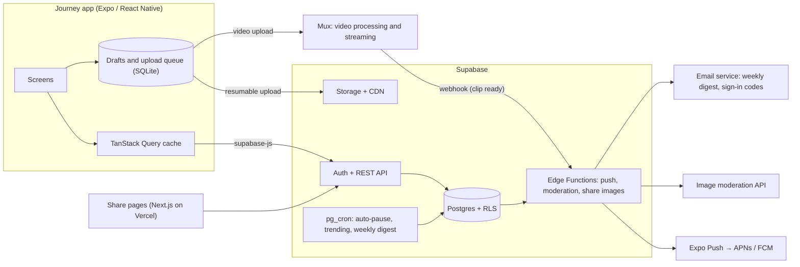

# Journey — Tech Stack and Architecture

> **Recommendation:** one TypeScript codebase. **Expo (React Native)** for the iOS and Android app, **Supabase** (Postgres) for the backend, and Expo's **EAS** cloud services to build and ship to the App Store and Google Play.

## Why this stack

| Need | How the stack meets it |
|---|---|
| iOS and Android without two teams | React Native draws real native UI from one codebase. Expo includes the camera, photos, location, maps and notifications. |
| Building the iOS app without a Mac | **EAS Build** compiles the iOS and Android apps in the cloud. That fits a workflow where Claude Code works in a Linux cloud environment. |
| Fixing bugs without waiting for store review | **EAS Update** sends JavaScript fixes straight to phones ("over the air"). |
| One language | TypeScript for the app, the backend functions and the web share pages. Simplest for a solo founder working with AI agents. |
| Social data (people, journeys, entries, follows, comments) | A relational **Postgres** database fits better than a document database. Feeds, counts and search are plain SQL. |
| Privacy rules (public, unlisted, private, blocking) | Enforced inside the database with **Row Level Security** (RLS), so a bug in the app can't leak a private journey. |
| Low cost, no lock-in | Free tiers until launch. Supabase is open source and can be self-hosted later. |

### Alternatives considered

| Option | Verdict |
|---|---|
| **Flutter + Firebase** | The strongest alternative, with excellent UI performance. Not chosen: Dart would be a second language next to TypeScript; Firestore makes feeds, follows and search harder than SQL; and it has no good answer for server-rendered share pages. |
| **Native Swift + Kotlin** | The best platform fit, but two codebases cost about twice the time and money. Not for an MVP. |
| **Kotlin / Compose Multiplatform** | Promising, but a smaller ecosystem for what a social app needs. |
| **Firebase instead of Supabase** | Fine for chat-style apps; weaker for a relational social graph and for analytics. |
| **Custom backend (Node + Postgres on AWS)** | More control, but you'd rebuild sign-in, storage and realtime yourself. Move there only if you outgrow Supabase. |

## The stack, layer by layer

### Mobile app

| Concern | Choice |
|---|---|
| Framework | **Expo**, the latest stable SDK when we scaffold ([SDK 57](https://releases.sh/collections/frontend-frameworks/digest/2026-06-29) at the time of writing; [58 is in beta](https://expo.dev/changelog/sdk-58-beta.md)), React Native, TypeScript (strict) |
| Navigation and deep links | **Expo Router** (file-based routes; universal links and app links for share URLs) |
| UI | Our own small component kit, matching the screens and components in the Journey Hub (`design/hub`). Colours, type and shapes come from `design/tokens.json`, turned into a typed theme. |
| Animation and gestures | Reanimated, Gesture Handler |
| Long lists (feed, timeline) | FlashList |
| Images | expo-image (caching, blurred placeholders) |
| Server data | TanStack Query (cache, instant likes, offline persistence) with supabase-js |
| Local state | Zustand |
| Offline drafts and upload queue | expo-sqlite |
| Forms and validation | React Hook Form + Zod (schemas shared with the backend) |
| Photos and video | expo-image-picker (photos, and clips up to 60 s) and expo-image-manipulator (resize photos to about 2048 px and make a thumbnail on the phone); clips compressed on the phone (for example with react-native-compressor); resumable uploads |
| Video playback | expo-video: streams the clip, shows a still frame and its length, plays when tapped |
| Location and maps | expo-location (permission, place names), react-native-maps (Apple Maps on iOS, Google Maps on Android) |
| Push notifications | expo-notifications with the Expo Push Service (APNs and FCM) |
| Sign-in | Sign in with Apple, Google, and email one-time codes, all through Supabase Auth |
| Analytics and crashes | PostHog and Sentry |
| Tests | Jest with React Native Testing Library; Maestro for end-to-end flows |

### Backend (Supabase)

| Concern | Choice |
|---|---|
| Database | Postgres with Row Level Security |
| Sign-in | Supabase Auth |
| Files | Supabase Storage with its CDN. The app uploads a full-size image and a thumbnail, so paid image transforms aren't needed. |
| Video | **Mux** (Cloudflare Stream is the cheaper alternative). The phone uploads clips straight to it; it converts them for streaming, picks the right quality for each connection, and makes still frames. An Edge Function hands out upload links, and a webhook marks each clip ready. |
| Server logic | SQL functions and triggers (counters, feed) plus **Edge Functions** in TypeScript (sending push notifications, moderation, share images) |
| Scheduled jobs | pg_cron: auto-pause after 30 days, trending scores, reminder nudges, the weekly digest |
| Email | A transactional email service (for example Resend), used for sign-in codes and for the weekly digest by email |
| Search | Postgres full-text search plus pg_trgm for fuzzy name matching; pgvector later for recommendations |
| Moderation | An image moderation API (for example AWS Rekognition or Google Cloud Vision SafeSearch), called when a photo is uploaded; for clips, it checks frames taken from the video |
| Schema changes | SQL migrations in the repo (`supabase/migrations`), applied with the Supabase CLI |

### Web (share pages only)

**Next.js on Vercel.** Public, read-only journey and entry pages with link-preview images, "Open in app / Get the app", the files that make universal links work, and the terms and privacy pages. It's added at the *Discover and share* milestone. During the beta these pages also get a sitemap and search-friendly titles and descriptions, so public journeys can be found through search engines.

### Delivery

GitHub Actions (lint, type-check and tests on every pull request) → EAS Build (store builds) → EAS Submit (uploads to App Store Connect and the Play Console) → EAS Update (fixes over the air).

## Architecture



## Data model (MVP)

| Table | Key columns |
|---|---|
| `profiles` | id (= the auth user), username (unique), display_name, avatar, bio, link, interests[] |
| `journeys` | id, owner_id, title, slug, description, category, tags[], cover, visibility (public · unlisted · private), status (active · paused · completed), label_style (day · part), template, start_date, completed_at, closing_note, last_entry_at, entry_count, follower_count |
| `entries` | id, journey_id, author_id, happened_at, body, place_name, lat, lng, location_precision (none · city · exact), is_milestone, like_count, comment_count, created_at, edited_at |
| `entry_media` | id, entry_id, type (photo · video), path, thumb_path, width, height, blurhash, duration_s, video_id, status (processing · ready · failed), position |
| `journey_members` | journey_id, user_id, role (owner · contributor), status (invited · active · left · removed), invited_by, joined_at |
| `journey_invites` | code, journey_id, created_by, expires_at, used_by (one-time links for friends who aren't on Journey yet) |
| `journey_follows` | user_id, journey_id, last_read_at (drives "new since your last visit"), notify |
| `creator_follows` | follower_id, creator_id |
| `likes` | user_id, entry_id |
| `comments` | id, entry_id, author_id, parent_id (one level of replies), body, created_at, deleted_at |
| `notifications` | id, user_id, type, actor_id, journey_id, entry_id, created_at, read_at |
| `push_tokens` | user_id, token, platform |
| `notification_prefs` | user_id, one switch for each type (new entries, completed journeys, comments, followers and invitations, likes, reminders), digest_push, digest_email, checkin_time |
| `reports`, `blocks` | reporter, target, reason, status · blocker_id, blocked_id |
| `templates` | id, name, category, label_style, prompts (JSON) |

The rules that matter:

- **Timeline order** is `happened_at`. **Day N** = the date of `happened_at` − `start_date` + 1.
- **Home feed order** is `created_at` (when it was posted), so a back-dated entry still shows up as new.
- **Visibility** is enforced by RLS. *Public* means everyone. *Unlisted* means anyone with the link, but it never appears in Discover, search or profile lists. *Private* means the owner only. Blocks apply both ways.
- **Auto-pause:** a daily job moves active journeys with no entry in 30 days to *paused* and nudges the creator.
- **Shared journeys:** a journey has one owner and up to 3 contributors. Active members can add entries and change their own; only the owner changes the journey or its members. RLS enforces both. Every entry keeps its `author_id`, and a profile lists the journeys a person owns or is an active member of.
- **Weekly digest:** a weekly job gathers, for each person, the new entries in the journeys they follow. It sends one push, plus one email to people who opted in, and nothing when there is nothing new.
- **Drafts live only on the phone** until they upload.
- **Video limits:** at most 3 clips per entry, each up to 60 seconds. Followers see a clip only once the video service reports it ready.

## Repository layout (when we scaffold)

```
journey/
├── apps/
│   ├── mobile/          # Expo app (iOS + Android)
│   └── web/             # Next.js share pages (added at the Discover and share milestone)
├── packages/
│   └── shared/          # types, Zod schemas, design tokens
├── supabase/
│   ├── migrations/      # schema + RLS policies
│   ├── functions/       # Edge Functions
│   └── seed.sql         # templates, demo content
├── docs/                # these documents
└── .github/workflows/   # CI
```

## Working in the cloud environment

This repo has its own cloud environment called **Journey** (Node 22 and npm, with package registries reachable). What happens where:

| Task | Where |
|---|---|
| Writing code, type-checks, lint, unit tests, database migrations, bundle checks | A cloud session |
| A quick look at screens | A cloud session, through the Expo web preview |
| iOS Simulator | Not available in the cloud (it needs macOS) |
| Testing on your phone | Install a development build once (made by EAS Build). After that, each change reaches your phone through EAS Update on a preview channel. |
| Store builds | EAS Build, in Expo's cloud |

What to add to the environment **when we scaffold the app** (there's nothing to install yet):

- **Network:** Expo's EAS hosts (`api.expo.dev` and the hosts EAS uploads to), the Supabase project host (`<project-ref>.supabase.co`), `api.supabase.com` for the CLI, and `api.mux.com` for video.
- **Keys**, saved as environment secrets and never in the repo: an Expo access token, a Supabase access token, a Mux API token and the email service's API key.
- **Setup script:** install dependencies (`npm ci`) so every new session starts ready.

## Running costs (approximate; check current prices)

| Item | Cost |
|---|---|
| Apple Developer Program | US$99 a year |
| Google Play Console | US$25, once |
| Supabase | Free while building; Pro is about US$25 a month at launch |
| Expo EAS | Free tier to start; a paid plan only for more or faster builds |
| Vercel | Free for development; Pro is about US$20 a month for commercial use |
| PostHog, Sentry | Free tiers cover an MVP |
| Email service | Free tier to start; check current limits |
| Image moderation | About US$1 per 1,000 photos |
| Video (Mux or Cloudflare Stream) | Pay as you go, by minutes stored and watched. As a guide, Cloudflare Stream charges about US$5 per 1,000 minutes stored and US$1 per 1,000 minutes watched. |
| Domain | About US$15 a year |

Expect roughly **US$75–150 a month** soon after launch, plus the store fees. Video is the cost that grows fastest with use, which is why clips are capped at 60 seconds.
