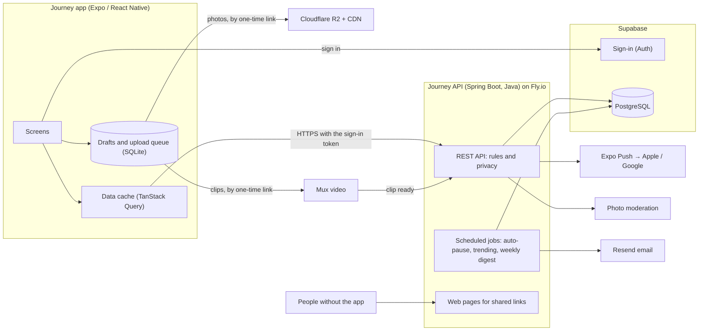

# Journey — Tech Stack and Architecture

> **Status:** final, decided on 9 Nov 2026. Versions, limits and prices were checked that day; prices can change, so look at the live page before paying for anything.
>
> **In one line:** an **Expo (React Native)** app for iOS and Android, a **Java (Spring Boot)** backend that you can read and debug, and managed services for everything that isn't worth building ourselves.

## The stack at a glance

| Layer | Choice | Why |
|---|---|---|
| Mobile app | **Expo SDK 58** (React Native 0.88, TypeScript) | One codebase for iOS and Android, built in the cloud with no Mac |
| Backend | **Journey API: Spring Boot 4 on Java** | You know Java, so you can debug and extend it. All the rules live in one place, with tests. |
| Database | **PostgreSQL**, hosted by Supabase | A relational database fits people, journeys, follows and feeds. Managed, with backups. |
| Sign-in | **Supabase Auth** | Apple, Google and email codes without building sign-in ourselves. Free up to 50,000 monthly users. |
| Photos | **Cloudflare R2** with its CDN | No charge for downloads, which is the big cost of a photo app |
| Video clips | **Mux** | Converts and streams clips. The first 100,000 minutes watched each month are free. |
| Push notifications | **Expo Push Service** | Free; one service reaches both Apple and Google |
| Email | **Resend** | Sign-in codes and the weekly digest. 3,000 emails a month free. |
| Hosting the API | **Fly.io** | About US$7 a month for an always-on server, next to the database |
| App builds and updates | **Expo Build, Submit and Update** (formerly EAS) | Store builds in the cloud, and fixes sent straight to phones |
| Web pages for shared links | Served by the Journey API, behind Cloudflare | No second codebase and no extra host |
| Analytics and crashes | **PostHog** and **Sentry** | Free tiers cover an MVP |
| Photo moderation | **AWS Rekognition** (confirmed at the safety milestone) | About US$1 per 1,000 photos |
| Automation | **GitHub Actions** | Tests on every pull request, and deploys |

## The backend decision: Java

You asked whether the backend can be Java. It can, and for this project it is the better choice. Three options were compared:

| Option | Speed to build | Who can debug it | Running it |
|---|---|---|---|
| **A. Supabase only.** The app talks to the database directly; rules are written as database policies and small TypeScript functions. | Fastest | Someone fluent in SQL policies and TypeScript | Nothing to host |
| **B. Java API on managed services (chosen).** A Spring Boot API holds all the rules. Supabase supplies the database and sign-in; other services supply storage, video and email. | 2 to 3 weeks slower than A | You, in Java, with a normal debugger and tests | One small server |
| **C. Everything in Java.** Our own sign-in, file handling and servers. | Slowest | You | The most to run and secure |

**Why B:**

1. **You can read, debug and change your own backend.** With the AI doing most of the building, the owner understanding the code is worth more than a few weeks.
2. **One place for the rules.** Who may see a private journey, what a co-author may change, what a blocked person can't do: plain Java with tests, instead of rules spread over database policies, triggers and functions.
3. **The app never talks to the database.** Old versions of the app stay on phones for months. With an API in between, the database can change without breaking them, requests can be rate-limited, and a mistake in the app can't expose the database.
4. **Nothing proprietary in the logic.** PostgreSQL, sign-in tokens and file storage are all standard, so any piece can be swapped later.

**What it costs:** about 2 to 3 more weeks for the first version (17 to 20 weeks in all) and a small server at about US$7 a month.

**What we still don't build:** sign-in, storage, video processing, email delivery and push delivery stay with managed services. Building those is where option C loses months.

## The stack, layer by layer

### Mobile app

| Concern | Choice | Why, and what else was considered |
|---|---|---|
| Framework | **Expo SDK 58**: React Native 0.88, React 19, TypeScript (strict), New Architecture | The current stable release. Flutter was the main alternative; it would add a second language (Dart) next to TypeScript. |
| Navigation and deep links | **Expo Router** | File-based routes; links to a journey open the right screen |
| Talking to the API | A typed client **generated from the API's own description** (OpenAPI, with Orval) | The app and the API can't drift apart: a changed endpoint fails the build instead of failing on a phone |
| Server data | **TanStack Query** | Caching, instant likes, retry and offline reads |
| Local state | **Zustand** | Small and simple |
| Offline drafts and upload queue | **expo-sqlite** | A real database on the phone; works in Expo Go. MMKV and op-sqlite need a custom build. |
| Uploads | **expo-file-system** upload tasks | Uploads continue when the app goes to the background on iOS |
| UI | Our own small component kit, styled with plain **StyleSheet** and a typed theme generated from `design/tokens.json` | No styling library to depend on. NativeWind 5 is still a release candidate, and Unistyles needs a custom build. |
| Glass and blur | **expo-glass-effect** on iOS 26 and later, **expo-blur** elsewhere | Real system glass where the phone supports it |
| Animation and gestures | **Reanimated 4**, **Gesture Handler** | The standard pair, included with Expo |
| Long lists | **FlashList 2** | Smooth feeds and timelines |
| Images | **expo-image** | Caching and blurred placeholders |
| Photos | **expo-image-picker**, **expo-image-manipulator** | Resize to about 2048 px and make a thumbnail on the phone before upload |
| Video | **expo-video** to play; **react-native-compressor** to shrink clips before upload | Mux has an official guide for expo-video. The compressor needs a development build (see [testing](#testing-without-the-store-accounts)). |
| Maps | **react-native-maps** | Supports our custom "Day 14" pins and works in Expo Go. Expo's own maps library needs iOS 17 or later. |
| Sign-in | **Supabase Auth** client with **expo-apple-authentication**, native Google sign-in, and email codes | Apple and email codes work in Expo Go. Google sign-in needs a development build. |
| Push | **expo-notifications** | Works with the Expo Push Service; needs a development build |
| Forms | **React Hook Form** with **Zod** | Validation with clear messages |
| Analytics and crashes | **PostHog**, **Sentry** | |
| Tests | **Jest** with React Native Testing Library; **Maestro** for end-to-end flows later | |

### Backend: the Journey API

| Concern | Choice | Why |
|---|---|---|
| Framework | **Spring Boot 4.1** (4.2 arrives on 19 Nov 2026), Spring MVC | The mainstream Java framework, and the one most Java developers know. Quarkus and Micronaut start faster, which doesn't matter for one always-on server. |
| Java version | **Java 25** (the current long-term version) in production. The code stays compatible with Java 21, which this cloud environment has. | Spring recommends 25; virtual threads work best from Java 24 on |
| Build | **Maven** | Familiar and predictable |
| Who is calling | **Spring Security** as a resource server: it checks the sign-in token from Supabase Auth against Supabase's public keys | Standard; no passwords or sessions in our code |
| Reading and writing data | **Spring Data JPA** for simple cases, plain SQL (`JdbcClient`) for feeds and search | Familiar, and SQL where SQL is clearer |
| Database changes | **Flyway** migrations in the repo | Every change is versioned and repeatable |
| API description | **springdoc-openapi** | Produces the OpenAPI document that the app's client is generated from |
| Rate limits | **Bucket4j**, stored in PostgreSQL | Stops abuse without adding another server such as Redis |
| Scheduled jobs | Spring's scheduler | Auto-pause after 30 days, trending scores, reminders, the weekly digest |
| Web pages for shared links | **Thymeleaf** templates served by the API | Read-only journey and entry pages, link previews, the files that make links open the app, terms and privacy pages |
| Outside services | Official Java SDKs for Mux, Resend and S3-compatible storage; plain HTTPS for Expo Push | |
| Tests | **JUnit** with Spring's test tools, against a real PostgreSQL | Proven in this cloud environment: a test app built and passed against PostgreSQL in about 20 seconds |
| Packaging | A Docker image, deployed by GitHub Actions | The same image runs anywhere |

### Managed services

| Service | Choice | Why, and what else was considered | Price |
|---|---|---|---|
| Database | **PostgreSQL on Supabase** | Comes with sign-in in one account. Supabase's automatic database API is switched off: only the Journey API connects. Neon and AWS were the alternatives. | Free while building (500 MB; pauses after a week unused). Pro US$25 a month at launch. |
| Sign-in | **Supabase Auth** | Apple, Google and email codes. Clerk costs about six times more per user at scale; Firebase has no email code. | Free to 50,000 monthly users; 100,000 on Pro |
| Photos | **Cloudflare R2**, served through Cloudflare's CDN | Downloads are free. Supabase Storage and AWS S3 charge about US$0.09 per GB downloaded. | 10 GB free, then US$0.015 per GB a month |
| Video | **Mux** | Direct uploads from the phone, streaming that adapts to the connection, still frames. At our scale it is cheaper than Cloudflare Stream and api.video. | Encoding free; about US$0.0024 per stored minute a month; first 100,000 watched minutes a month free |
| Push | **Expo Push Service** | One call reaches Apple and Google | Free |
| Email | **Resend** | Simple, with an official Java SDK. AWS SES is cheaper at volume and harder to set up. | 3,000 a month free; US$20 for 50,000 |
| API hosting | **Fly.io** | The cheapest always-on option, with regions next to the database. Railway, Render and Google Cloud Run were compared; Heroku is no longer developed. | About US$7 a month for 1 GB |
| App builds and updates | **Expo services** | Builds iOS in the cloud | Free: 15 iOS and 15 Android builds a month, updates for 1,000 users. Then US$19 a month. |
| Domain, DNS, CDN | **Cloudflare** | Also in front of the share pages | Free plan |
| Analytics | **PostHog** | | 1 million events a month free |
| Crash reports | **Sentry** | | 5,000 errors a month free |
| Photo moderation | **AWS Rekognition**, to confirm at the safety milestone | Its labels tell explicit content apart from swimwear, which matters for travel photos. OpenAI's moderation service is free, but its terms for this use weren't confirmed. Clips are checked by their still frames. | About US$1 per 1,000 photos |

**Region:** the database and the API sit in the same region so they answer quickly. The default is US East (Virginia); it can be chosen when the accounts are created.

### Delivery

GitHub Actions run the app's checks (lint, types, tests) and the API's tests (against PostgreSQL) on every pull request. Merging deploys the API to Fly.io. The app goes through Expo Build (store builds), Expo Submit (upload to App Store Connect and the Play Console) and Expo Update (fixes over the air).

## Architecture



## Data model (MVP)

| Table | Key columns |
|---|---|
| `profiles` | id (= the signed-in user), username (unique), display_name, avatar, bio, link, interests[] |
| `journeys` | id, owner_id, title, slug, description, category, tags[], cover, visibility (public · unlisted · private), status (active · paused · completed), label_style (day · part), template, start_date, completed_at, closing_note, last_entry_at, entry_count, follower_count |
| `entries` | id, journey_id, author_id, happened_at, body, place_name, lat, lng, location_precision (none · city · exact), is_milestone, like_count, comment_count, created_at, edited_at |
| `entry_media` | id, entry_id, type (photo · video), path, thumb_path, width, height, blurhash, duration_s, video_id, status (processing · ready · failed), position |
| `journey_members` | journey_id, user_id, role (owner · contributor), status (invited · active · left · removed), invited_by, joined_at |
| `journey_invites` | code, journey_id, created_by, expires_at, used_by (one-time links for friends who aren't on Journey yet) |
| `journey_follows` | user_id, journey_id, last_read_at (drives "new since your last visit"), notify |
| `creator_follows` | follower_id, creator_id |
| `likes` | user_id, entry_id |
| `comments` | id, entry_id, author_id, parent_id (one level of replies), body, created_at, deleted_at |
| `notifications` | id, user_id, type, actor_id, journey_id, entry_id, created_at, read_at |
| `push_tokens` | user_id, token, platform |
| `notification_prefs` | user_id, one switch for each type (new entries, completed journeys, comments, followers and invitations, likes, reminders), digest_push, digest_email, checkin_time |
| `reports`, `blocks` | reporter, target, reason, status · blocker_id, blocked_id |
| `templates` | id, name, category, label_style, prompts (JSON) |

The rules that matter:

- **Timeline order** is `happened_at`. **Day N** = the date of `happened_at` − `start_date` + 1.
- **Home feed order** is `created_at` (when it was posted), so a back-dated entry still shows up as new.
- **Visibility** is enforced in the Journey API, in one place, with tests. *Public* means everyone. *Unlisted* means anyone with the link, but it never appears in Discover, search or profile lists. *Private* means the owner only. Blocks apply both ways. The database itself can't be reached from the app or the internet.
- **Shared journeys:** a journey has one owner and up to 3 contributors. Active members can add entries and change their own; only the owner changes the journey or its members. Every entry keeps its `author_id`, and a profile lists the journeys a person owns or is an active member of.
- **Photos** of public and unlisted journeys are served from the CDN at addresses that can't be guessed. Photos of private journeys are served through short-lived signed links.
- **Auto-pause:** a daily job moves active journeys with no entry in 30 days to *paused* and nudges the creator.
- **Weekly digest:** a weekly job gathers, for each person, the new entries in the journeys they follow. It sends one push, plus one email to people who opted in, and nothing when there is nothing new.
- **Drafts live only on the phone** until they upload.
- **Video limits:** at most 3 clips per entry, each up to 60 seconds. Followers see a clip only once Mux reports it ready.

## Repository layout (when we scaffold)

```
journey/
├── apps/
│   ├── mobile/          # Expo app (iOS + Android), TypeScript
│   └── api/             # Journey API: Spring Boot (Java), with its database migrations and share pages
├── packages/
│   └── api-client/      # TypeScript client generated from the API's OpenAPI document
├── design/              # tokens.json and the Journey Hub
├── docs/                # these documents
└── .github/workflows/   # tests and deploys
```

## Testing without the store accounts

Development can start today. The Apple and Google accounts are only needed to install a real build on a phone and to release in the stores.

| Stage | What you need | How we test | What it covers |
|---|---|---|---|
| **1. Now** | Nothing | I run the API's tests against a real database in the cloud, and I run the app as a web page that I check with screenshots | Screens, navigation, forms, and every rule in the API |
| **2. On your iPhone** | Three free accounts: Expo, Supabase, Fly.io | **Expo Go.** Install it free from the App Store and sign in with your Expo account. I publish each change, and you open it from Expo Go's project list or a QR code. No cable. | Most of the first two milestones: sign-in with an email code or Apple, profiles, journeys, entries, photos and the timeline |
| **3. A real build** | Apple Developer Program, US$99 a year | A development build of Journey installed on your iPhone; later TestFlight for the beta | What Expo Go can't run: push notifications, Google sign-in, video compression, links that open the app |
| **4. Android and the stores** | Google Play Console, US$25 once | Android testers, then the store | A new personal account must run a closed test with 12 testers for 14 days before it can publish |

Good to know:

- **Expo Go** on the App Store runs only the newest Expo version, SDK 58, which is the one we use. Expo's documentation describes opening a published update in Expo Go. I haven't run that end to end yet, so the first publish is the test. If it doesn't work, the fallbacks are an Android phone (a build installs with no account at all) and the web preview.
- **A cable** only helps if you have a Mac with Xcode. Then a build can go onto your iPhone with a free Apple ID, but it expires after 7 days and can't use push notifications or Sign in with Apple.
- **Enrol with Apple early.** Apple says processing can take up to 48 hours; in 2026 people report one to several weeks. We need it from the video milestone on.

## Accounts, and when each is needed

| Account | Cost | Used for | Needed from |
|---|---|---|---|
| Expo | Free to start | Builds, and updates to your phone | The first test on your iPhone |
| Supabase | Free to start | Database and sign-in | The first test on your iPhone |
| Fly.io | About US$7 a month; needs a card | Hosting the API | The first test on your iPhone |
| Resend | Free to start | Sign-in codes by email, the weekly digest | Sign-in codes for other people |
| Cloudflare | Free to start | Photo storage, CDN, the domain | The Create milestone |
| Apple Developer Program | US$99 a year | iPhone builds, TestFlight, push, the App Store | The Video milestone. Enrol now. |
| Mux | Pay as you go | Video clips | The Video milestone |
| Google Cloud and Firebase | Free | Google sign-in, Android push | The Follow milestone |
| A domain name | About US$15 a year | Share links | The Discover and share milestone |
| PostHog, Sentry | Free to start | Analytics, crash reports | The Finish milestone |
| AWS | About US$1 per 1,000 photos | Photo moderation | The Finish milestone |
| Google Play Console | US$25 once | Android testing and release | Before the beta |

Keys for these services are saved as secrets in the cloud environment, never in the repo.

## Working in the cloud environment

This repo has its own cloud environment called **Journey**. It already has what both halves of the stack need: Node 22 for the app, and Java 21, Maven and PostgreSQL 16 for the API.

| Task | Where |
|---|---|
| Writing code, type-checks, lint, tests for the app and the API, database migrations | A cloud session |
| A quick look at screens | A cloud session, through the Expo web preview |
| Testing on your iPhone | Expo Go first, then a development build |
| iOS Simulator | Not available in the cloud (it needs a Mac) |
| Store builds | Expo Build, in Expo's cloud |

To add to the environment as each account is created: the service's host on the network allowlist (Expo, the Supabase project, Fly.io, Cloudflare, Mux, Resend) and its key as a secret. A setup script will install the dependencies so every new session starts ready.

## Running costs (approximate)

| Item | While building | Soon after launch |
|---|---|---|
| Apple Developer Program | US$99 a year | US$99 a year |
| Google Play Console | US$25, once | |
| Supabase | Free | US$25 a month |
| Fly.io | Under US$10 a month | About US$7 to 15 a month |
| Cloudflare R2 | Free | A few dollars a month |
| Mux | Free allowance | Pay as you go; small at first |
| Resend | Free | Free, then US$20 a month |
| Expo | Free | Free, then US$19 a month |
| PostHog, Sentry | Free | Free |
| Photo moderation | | About US$1 per 1,000 photos |
| Domain | | About US$15 a year |

Expect **under US$10 a month while building**, plus Apple's fee, and roughly **US$60 to 120 a month soon after launch**. Video and photo storage are the costs that grow with use, which is why clips are capped at 60 seconds.

## Alternatives considered

| Option | Verdict |
|---|---|
| **Supabase only, no Java** | The fastest route and a good one. Not chosen because you couldn't debug the backend in your own language, and the app would depend directly on the database. |
| **Flutter instead of Expo** | Excellent UI performance. Not chosen: Dart would be another language, and Expo builds iOS in the cloud without a Mac. |
| **Native Swift and Kotlin** | The best platform fit, but two apps cost about twice the time. |
| **Quarkus or Micronaut instead of Spring Boot** | Faster start-up and less memory. Not needed for one always-on server, and Spring is what most Java developers know. |
| **Firebase** | Fine for chat-style apps; weaker for a relational social graph, and its email sign-in has no code option. |
| **Next.js on Vercel for the share pages** | Works, but it is a second codebase and US$20 a month for commercial use. The Java API serves these pages instead. |
| **Supabase Storage or AWS S3 for photos** | Both charge for downloads; R2 doesn't. |
| **Cloudflare Stream, Bunny Stream or api.video for video** | Mux is the cheapest at our scale and has official guides for Expo's video player. |

## What was checked, and where

Checked on 9 Nov 2026 against the vendors' own pages and package registries: [Expo SDK 58](https://expo.dev/changelog/sdk-58) and [Expo pricing](https://expo.dev/pricing), [Spring Boot releases](https://spring.io/blog/category/releases), [Supabase pricing](https://supabase.com/pricing) and [signing keys](https://supabase.com/docs/guides/auth/signing-keys), [Cloudflare R2 pricing](https://developers.cloudflare.com/r2/pricing/), [Mux pricing](https://www.mux.com/pricing), [Fly.io pricing](https://fly.io/docs/about/pricing/), [Resend pricing](https://resend.com/pricing), [Apple enrolment](https://developer.apple.com/programs/enroll/) and [Google Play's testing rule](https://support.google.com/googleplay/android-developer/answer/14151465). Some pricing pages could only be read through search results from this environment, so treat the prices as close, not exact.
