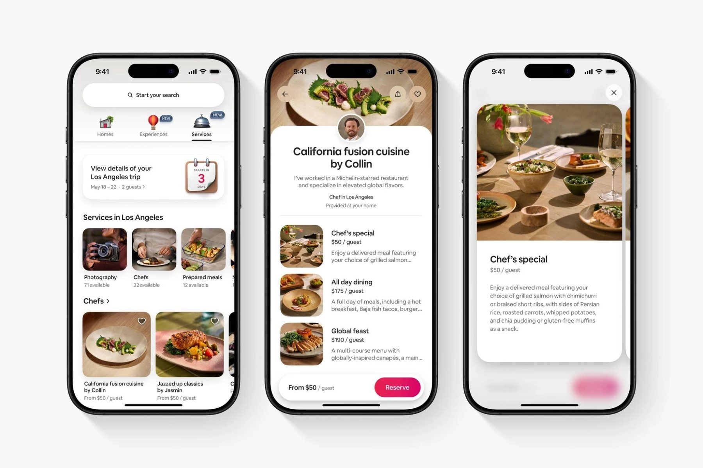
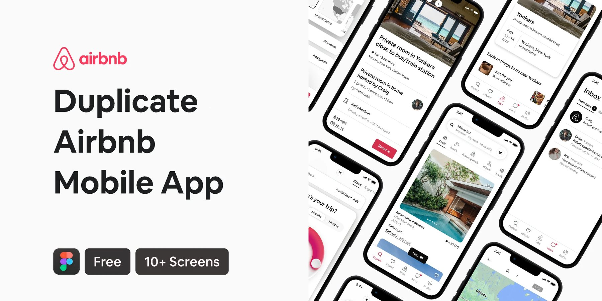
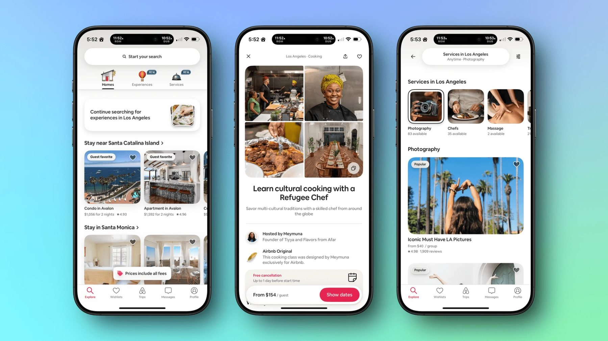
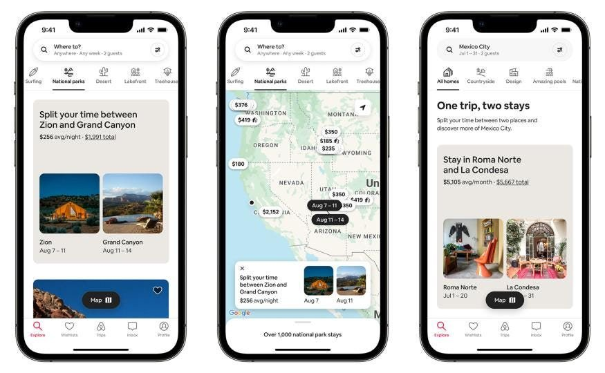
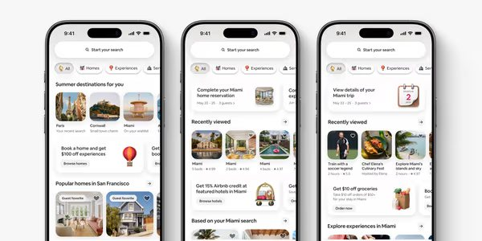

# Journey — Inspiration

> References you shared on 7 Nov 2026, and what Journey takes from each. The images live in `design/hub/inspiration/`. They are Airbnb's and are kept only as private references.

## 1. Airbnb services and experiences (2025)

**What we take:**
- The floating search pill and the category tabs with 3D icons and NEW badges.
- The "your trip starts in 3 days" context card, which becomes our "Day 12 of your challenge" card.
- The listing page: big photo, host's face on an overlapping sheet, centred title. This becomes our Journey page.
- The card that opens over the page with the next one peeking in. This becomes our Entry view.
- The floating "From $50 · Reserve" bar, which becomes our Follow bar.

**What we leave:** prices and booking language, Airbnb's pink, and its typeface.

## 2. Airbnb app kit (Figma community)

**What we take:** a calm white system with strong type hierarchy, the inbox list pattern for Activity, and the map with pills for the journey map.

**What we leave:** dense listing details and amenity lists.

## 3. Airbnb experiences (2025)

**What we take:**
- Pill labels on photos ("Guest favorite" becomes "3 new").
- A 2×2 photo mosaic at the top of a detail page.
- The host row and the sticky bottom action bar.
- A small reassuring toast ("Prices include all fees" becomes "Saved offline").

**What we leave:** the price-first layout.

## 4. Airbnb split stays and map

**What we take:** the icon category row under search, collection cards that pair two photos, price pills on the map (our Day pills), and the floating Map/List switch.

## 5. Airbnb home (2025)

**What we take:** chips with small 3D icons, rounded destination tiles, horizontal rails with "See all", and friendly 3D objects on promo cards.

## Photo direction

- Real people in real places, natural light, golden hour when possible.
- Show the journey, not the selfie: hands on a map, a traveler among scooters, a moment of progress.
- Motion where it helps: a jump, a wave, a stroke in the water.
- Avoid posed stock photography, heavy filters and text baked into photos.

## Apps to learn from

| App | Learn from | Avoid |
|---|---|---|
| Airbnb | Layout, warmth, clarity | The booking and price focus |
| Instagram | Media-first viewing, simple posting | The endless algorithmic feed, vanity metrics |
| Strava | Progress, stats and kudos for challenges | Leaderboard pressure |
| Polarsteps | Trip maps and routes | GPS tracking as the core; travel only |
